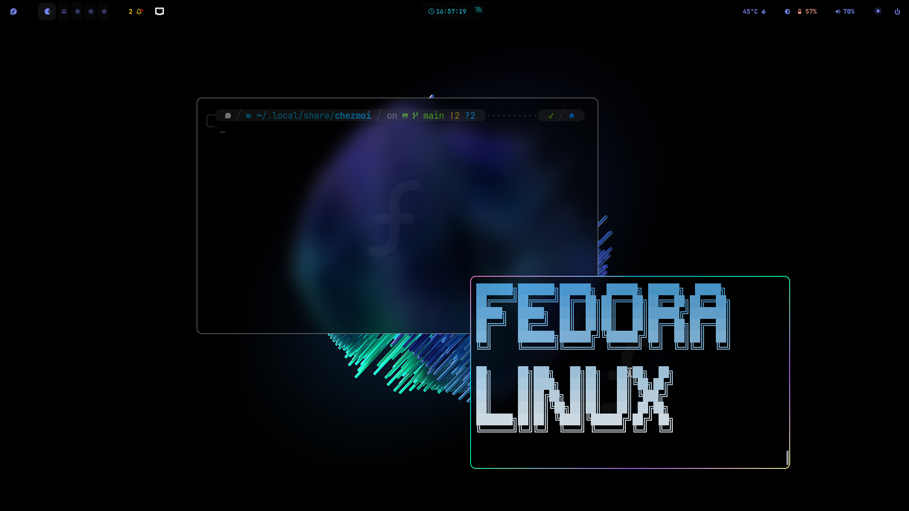
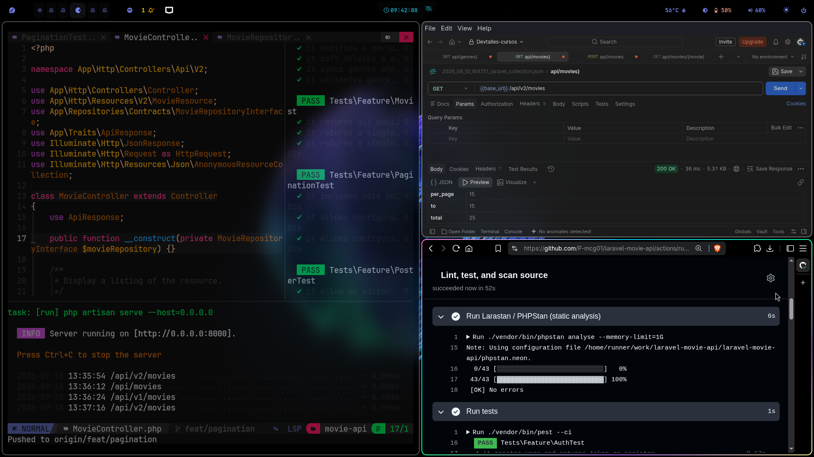

# Personal Dotfiles

A modern Linux desktop focused on productivity, simplicity, and a keyboard-first workflow.

Built on Fedora Linux with Hyprland, Kitty, and Zsh.


## Overview

This repository contains my personal Linux configuration files managed with [chezmoi](https://www.chezmoi.io/).

For a detailed history of changes, see the [CHANGELOG.md](./CHANGELOG.md).

## Showcase





## Development

### Dotfiles formatting and linting

The repository uses Taskfile to automate formatting checks and linting across the dotfiles in `./home/`. The following tasks orchestrate the individual formatters and linters.

| Task         | Description                                                    |
| ------------ | -------------------------------------------------------------- |
| `task fmt`   | Format all supported dotfiles using the configured formatters. |
| `task check` | Check formatting without modifying files.                      |
| `task lint`  | Run all configured linters against supported dotfiles.         |

#### Formatting

Run the formatter task after modifying configuration files:

```bash
task fmt
```

To check whether files are correctly formatted without changing them, run:

```bash
task check
```

#### Linting

Run all configured dotfiles linters with:

```bash
task lint
```

Currently, this task runs [selene](https://kampfkarren.github.io/selene/) to lint Lua configuration files under `./home/dot_config/`. Additional linting tasks for shell scripts, GitHub actions workflows, and container files are available through their **respective namespaces**.

### Testing on containers

For safe testing of configurations without affecting the local system, this repository provides a containerized development environment powered by [Podman](https://podman.io/) and [Taskfile](https://taskfile.dev/).

> [!NOTE]
> Container-related tasks are grouped under the container namespace and can be invoked using the `ct` alias.

#### Execution of test containers

1. Copy the environment template file:

```bash
cp .env.example .env
```

2. Define the `DOPPLER_TOKEN` variable inside `.env`.

> [!IMPORTANT]
> This token is injected into the container during execution. Manual installation of the Doppler CLI inside the container is not required, as a hook manages the installation process automatically.

3. To launch an interactive container session, the following task command is executed:

```bash
task container:run:<OS> [TAG="<version>"]

# alternatively, use the ct alias
task ct:run:<OS> [TAG="<version>"]
```

- `<OS>`: Target distribution ( [fedora](https://github.com/P-mcg01/dotfiles/pkgs/container/dotfiles-fedora) or [debian](https://github.com/P-mcg01/dotfiles/pkgs/container/dotfiles-debian) ).
- `TAG`: Container image tag from GHCR. Defaults to `dev` when omitted.

Example:

```bash
task ct:run:fedora TAG=v26.9.5-r2.2
```

4. An interactive TTY session opens directly at `~/.local/share/chezmoi`, where you can inspect the configuration status:

```bash
chezmoi status
```

#### Container formatting and linting

The repository provides tasks to format and lint Containerfiles using [dockerfmt](https://github.com/reteps/dockerfmt) and [hadolint](https://hadolint.com/), respectively.

| Task                | Description                                              |
| ------------------- | -------------------------------------------------------- |
| `task ct:fmt`       | Format Containerfiles with dockerfmt.                    |
| `task ct:fmt:check` | Check Containerfile formatting without applying changes. |
| `task ct:lint`      | Lint Containerfiles with Hadolint.                       |

#### Container image signature verification

Published container images can be verified using [Cosign](https://docs.sigstore.dev/cosign/signing/overview/), which checks their keyless signatures. Run the verification task for the target distribution:

```bash
task ct:verify:<OS>

```

For example:

```bash
task ct:verify:fedora TAG=v26.9.30-r15.10
```

Verification applies to published images and does not replace the local build and testing workflow.

#### Local container builds

To test modifications made to `validation/containers/` prior to opening a Pull Request, container images must be built locally using:

```bash
task ct:build:<OS>
```

This command parses the corresponding `Containerfile` under `validation/containers/<OS>` and generates a local image tagged as `dev`.
